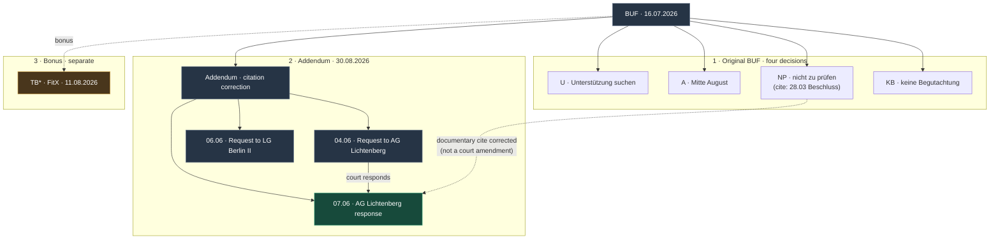

# BUF — Berliner Umgehungsformel

Primary Sources & Court Documents for **BUF = U + A + NP + KB + TB***

- **U** — Unterstützung suchen
- **A** — bis Mitte August
- **NP** — nicht zu prüfen
- **KB** — keine Begutachtung
- ***TB**— Termine buchen *(bonus plus)*

Published texts

| File | Role |
|------|------|
| <a href="./2026-07-16%20-%20BUF.pdf"><code>2026-07-16 - BUF.pdf</code></a> | Main brochure — four heuristics, four Anlagen |
| <a href="./2026-08-30%20-%20BUF%20-%20Addendum.pdf"><code>2026-08-30 - BUF - Addendum.pdf</code></a> | Citation correction for **NP** + coordination evidence |
| <a href="./analyse/formel.de.md">de</a> · <a href="./analyse/formel.en.md">en</a> · <a href="./analyse/formel.uk.md">uk</a> | Forensic analysis — Gegenstand before reasons; two levels; epistemic status (no AZ, no judge names) |

Letter folders hold the **source court / party documents** (white-redacted). Each PDF has a companion `.txt` extract.

---

## Index — what is where

Page = PDF page of the formula quote (same number as `--- Seite N ---` in the companion `.txt`).

| Folder | Formula | Page | Court / matter | Documents |
|--------|---------|------|----------------|-----------|
| [`U/`](U/) | Unterstützung suchen | **p. 3** | LG Berlin II | <a href="./U/2025-06-13%20-%20Urteil.pdf">Urteil 13.06.2025</a> · <a href="./U/2025-06-06%20-%20Psychologischen%20Begutachtung.pdf">Schriftsatz 06.06.2025</a> (Addendum) |
| [`A/`](A/) | bis Mitte August | **p. 2** | AG Kreuzberg | <a href="./A/2025-07-22%20-%20Urteil.pdf">Urteil 22.07.2025</a> |
| [`NP/`](NP/) | nicht zu prüfen | **p. 1** | AG Lichtenberg | **Main after Addendum:** <a href="./NP/2025-06-07%20-%20Lichtenberg.pdf">Schreiben 07.06.2025</a> · <a href="./NP/2025-03-28%20-%20Beschluss.pdf">Beschluss 28.03.2025</a> (BUF Anlage) · <a href="./NP/2025-06-04%20-%20Psychologischen%20Begutachtung.pdf">Schriftsatz 04.06.2025</a> |
| [`KB/`](KB/) | keine Begutachtung | **p. 3** | AG Kreuzberg | <a href="./KB/2025-07-10%20-%20Urteil.pdf">Urteil 10.07.2025</a> |
| [`TB/`](TB/) | Termine buchen / AU days *(bonus)* | **p. 3** | AG Lichtenberg FitX | <a href="./TB/2026-08-11%20-%20Urteil.pdf">Urteil 11.08.2026</a> |

---

## How documents relate

 The 28.03 Beschluss remains as the original BUF Anlage for chronology — the Addendum corrects the **citation**, it does not amend that decision. 
 **TB** is not an Anlage of BUF/Addendum — FitX bonus (*an einzelnen Tagen* + *Termine gebucht*).
